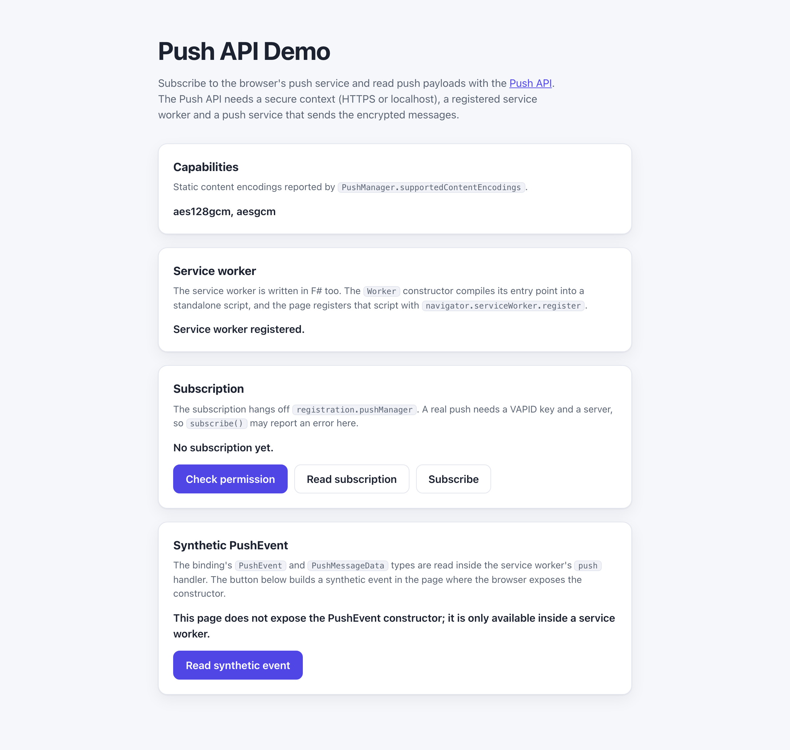

# WebSharper.Push

[](https://github.com/dotnet-websharper/PushAPI)

WebSharper bindings for the [Push API](https://developer.mozilla.org/en-US/docs/Web/API/Push_API) —
subscribing to a push service and receiving push messages in a service worker from F# and C# web apps.

The Push API requires a [secure context](https://developer.mozilla.org/en-US/docs/Web/Security/Defenses/Secure_Contexts)
(HTTPS or localhost), a push service (such as FCM or Mozilla autopush) and a registered service worker.

This repository contains:

| Project | Purpose |
| --- | --- |
| `WebSharper.Push` | The binding: WIG definitions for `PushManager`, `PushSubscription`, `PushSubscriptionOptions`, `PushMessageData`, `PushEvent`, and their string enums. |
| `WebSharper.Push.Extensions` | `[<Inline>]` helpers bridging the `WebSharper.ServiceWorker` binding (`pushManager`, the notification-click listener) with the Push types. |
| `WebSharper.Push.Sample` | An ASP.NET Core SPA sample that reports the browser's push capabilities, registers a service worker and drives the push subscription. The service worker is written in F# too, on top of the `WebSharper.ServiceWorker` binding. |

## Live demos

**Try it live:** [Open the sample in your browser](https://dotnet-websharper.github.io/PushAPI/)



The sample doubles as the binding's [test case](#running-the-sample): it reads
`PushManager.supportedContentEncodings`, registers a service worker, queries `permissionState` and
`getSubscription`, and attempts `subscribe`. A real push still needs a VAPID key and a server, so the
sample reports the browser's own error instead of faking a subscription.

Both the page and the service worker are written in F#. The service worker's entry point goes through the
`Worker` constructor, so the compiler produces a standalone script
(`WebSharper.Push.Sample.service-worker.js`) that the page then registers as the service worker.

- **Sample (this repository):** <https://dotnet-websharper.github.io/PushAPI/>
- **MDN Push API:** <https://developer.mozilla.org/en-US/docs/Web/API/Push_API>
- **Binding source:** <https://github.com/dotnet-websharper/PushAPI>
- **WebSharper bindings:** <https://websharper.com/bindings>

## Features

- `PushManager` with `getSubscription`, `permissionState`, `subscribe`, and the static `supportedContentEncodings`.
- `PushSubscription` with `endpoint`, `expirationTime`, `options`, `getKey`, `toJSON`, and `unsubscribe`.
- `PushSubscriptionOptions` (`userVisibleOnly`, `applicationServerKey`).
- `PushMessageData` (`arrayBuffer`, `blob`, `bytes`, `json`, `text`).
- `PushEvent` (inheriting `Dom.Event`) with `data`, plus the `PushEventInit` dictionary.
- `PushPermissionState` and `PushEncryptionKeys` string enums.

## Installation

The binding is not currently published to NuGet. Reference the project from source:

```bash
git clone https://github.com/dotnet-websharper/PushAPI.git
```

```xml
<ItemGroup>
  <ProjectReference Include="path/to/WebSharper.Push/WebSharper.Push.fsproj" />
  <ProjectReference Include="path/to/WebSharper.Push.Extensions/WebSharper.Push.Extensions.fsproj" />
</ItemGroup>
```

The Extensions project builds on the `WebSharper.ServiceWorker` binding, which is also required.

## Usage

```fsharp
namespace WebSharper.Push.Demo

open WebSharper
open WebSharper.JavaScript
open WebSharper.Push

[<JavaScript>]
module Demo =
    /// Subscribe the current service worker registration to the push service.
    let subscribe (registration: obj) =
        promise {
            let manager = registration?pushManager |> As<PushManager>
            let options = PushSubscriptionOptions(UserVisibleOnly = true)
            let! subscription = manager.Subscribe(options)
            return subscription.Endpoint
        }
```

`registration` is a `ServiceWorkerRegistration`; its `pushManager` property exposes the `PushManager`. The
`PushSubscriptionOptions` dictionary is passed to `subscribe()`, and `userVisibleOnly = true` is required by
Chromium-based browsers.

### The service worker in F#

The service worker is ordinary F# as well. `Worker` compiles its entry point into a standalone script, so
passing a function to the constructor gives you both the script and the worker. Register the generated
script with the browser's service worker API, and handle `push` there, reading the payload through
`PushMessageData`:

```fsharp
[<JavaScript>]
module ServiceWorker =
    // The service worker global scope is not modelled by core, so reach the
    // service-worker-only APIs through inline accessors.
    [<Inline "$self.addEventListener('push', $handler)">]
    let onPush (self: obj) (handler: PushEvent -> unit) : unit = X<unit>

    [<Inline "$self.registration.showNotification($title, { body: $body })">]
    let showNotification (self: obj) (title: string) (body: string) : Promise<unit> = X<Promise<unit>>

    [<Inline "$event.waitUntil($promise)">]
    let waitUntil (event: obj) (promise: obj) : unit = X<unit>

    let EntryPoint (self: DedicatedWorkerGlobalScope) =
        let scope = box self
        onPush scope (fun event ->
            let data = event.Data
            let body = if Optional.isDefined data then data.Value.Text() else "No payload"
            waitUntil (box event) (showNotification scope "Push received" body))
```

The script is emitted as a module, so register it with `type: "module"`:

```fsharp
[<JavaScript>]
module Client =
    [<Inline "$navigator.serviceWorker">]
    let serviceWorker (navigator: obj) : obj = X<obj>

    [<Inline "$sw.register($path, { type: 'module' })">]
    let register (sw: obj) (path: string) : Promise<obj> = X<Promise<obj>>

    let registerWorker () =
        promise {
            // The Worker constructor compiles the service worker's entry point
            // into a standalone script; we only need the script, so the worker
            // itself is terminated straight away.
            let worker = new Worker("service-worker", fun self -> ServiceWorker.EntryPoint self)
            worker.Terminate()
            let sw = serviceWorker JS.Window.Navigator
            let! registration = register sw "Content/workers/WebSharper.Push.Sample.service-worker.js"
            return registration
        }
```

The `Worker` constructor emits the script into `Content/workers/`, so `wsconfig.json` sets
`"scriptBaseUrl": "/Content/"` to keep the generated path in sync with `outputDir`.

## Running the sample

Build the sample in Release and serve it from the ASP.NET Core host (or any static server):

```bash
dotnet build WebSharper.Push.Sample/WebSharper.Push.Sample.fsproj -c Release
dotnet run --project WebSharper.Push.Sample/WebSharper.Push.Sample.fsproj
```

Open <http://localhost:50560/>. The page reports the browser's supported content encodings, registers
the generated service worker, and lets you query the permission state, read the existing subscription and
try to subscribe. The service worker's `push` handler logs incoming payloads and shows a notification.

The service worker script is generated at build time by the `Worker` constructor, so it is not committed;
the `wwwroot/Content` folder is a build output.

## Building from source

### Prerequisites

- [.NET SDK 10](https://dotnet.microsoft.com/download) or later.

### Build

```bash
dotnet build WebSharper.Push.sln -c Release
```

The binding targets `netstandard2.0`; the sample targets `net10.0`.

## Deployment

Pushing to `main` triggers `.github/workflows/ghpages.yml`, which builds the sample in Release and publishes
`wwwroot` — including the generated service worker — to the `gh-pages` branch.

## Repository layout

```
WebSharper.Push/            # binding (WIG definitions)
  Main.fs
  WebSharper.Push.fsproj
  wsconfig.json
WebSharper.Push.Extensions/ # [<Inline>] helpers bridging the ServiceWorker binding
  Library.fs
WebSharper.Push.Sample/     # ASP.NET Core SPA sample
  Client.fs                 # the page and the F# service worker
  Startup.fs
  wwwroot/
    index.html
    site.css
docs/sample.png
.github/workflows/ghpages.yml   # build + deploy the sample to GitHub Pages
README.md
LICENSE.md
```

## Notes on the API

- **Secure context:** the Push API is only exposed in secure contexts. Serve the page over HTTPS or from localhost.
- **Push service:** a push subscription is tied to a browser push service (FCM, Mozilla autopush, and so on) and to a
  server that sends the encrypted messages.
- **Service worker:** `subscribe()` must be called on a service worker registration, and a service worker must handle
  the `push` event. Use `ServiceWorkerRegistration.pushManager` to obtain the `PushManager`. The sample writes that
  worker in F# and registers the script the `Worker` constructor generates.
- **`Worker` and module scripts:** the `Worker` constructor emits an ES module, so the page registers it with
  `{ type: "module" }` and the worker's scope stays at the script's directory (`Content/workers/`). The page itself is
  not controlled by the worker, which is fine for the Push API — it only needs the registration.
- **User gesture:** call `subscribe()` from a user gesture (for example, a button click). Browsers may reject the
  request otherwise, and the user is asked for notification permission.
- **`userVisibleOnly`:** pass `PushSubscriptionOptions(UserVisibleOnly = true)` to `subscribe()` and `permissionState()`.
  Chromium rejects a subscription that does not enable it.
- **`applicationServerKey`:** `PushSubscriptionOptions.applicationServerKey` accepts an `ArrayBuffer`, any typed array
  (`ArrayBufferView`), or a base64url-encoded `string` (the VAPID public key).
- **Nullable values:** `PushManager.getSubscription()` resolves to `null` when there is no subscription,
  `PushSubscription.expirationTime` and `PushSubscription.getKey()` may be `null`, and `PushEvent.data` may be `null`.
  The binding models these as `Optional<'T>`; check with `Optional.isUndefined` and `isNull`.
- **`supportedContentEncodings`:** the static `PushManager.supportedContentEncodings` property is a `string[]`.
- **`PushEvent` constructor:** the browser only exposes it inside a service worker, so the page cannot build a
  synthetic event. The sample's F# service worker reads `event.data` in its `push` handler instead.
- **Browser support:** supported by Chromium-based browsers and Firefox; Safari supports the Push API for web apps
  added to the Home Screen (iOS 16.4+).

## License

Apache 2.0 — see [LICENSE.md](LICENSE.md).
